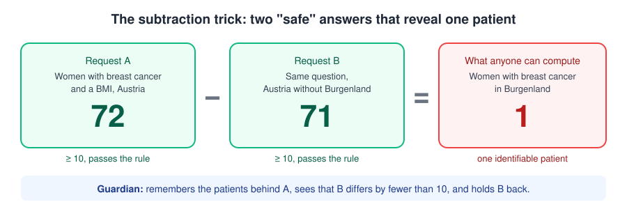
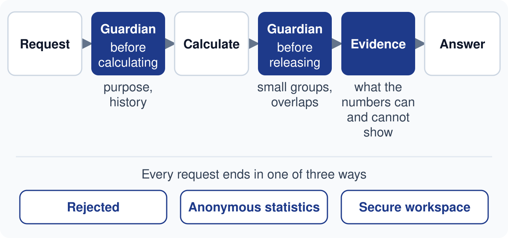

# Health Data Navigator

- **Works:** All 10 official requests are correct. The app catches subtraction attacks within an organisation, catches purpose changes, and provides a locked workspace with no download.
- **Not yet:** No logins. The Guardian's memory is per organisation name and resets on restart. Some new question types (e.g. per hospital) are not understood.
- **Next:** Logins, a shared permanent memory, and broader question understanding.

---

## Why Health Data Navigator stands out

Most data-access tools judge each answer on its own. Ours also thinks like an attacker and like a scientist.

### 1. It catches the leak others miss

Every access body hides groups smaller than 10. But two harmless-looking questions can still expose patients:

<p align="center"></p>

A rule-following tool releases both answers. Our **Guardian** compares each new answer with the earlier ones from the same organisation. If the two differ by only 1–9 patients, it holds the new answer back.

### 2. It notices when the purpose changes

A team approved for research returns asking for records to set insurance premiums, a use EHDS law forbids. The Guardian connects the two requests, rejects the second under Art. 54 and alerts staff.

### 3. It tells researchers what the numbers cannot prove

*"Does obesity cause breast cancer?"* In our data, every BMI value of these women was recorded after the diagnosis. The data cannot show whether obesity came first. Our **Evidence Investigator** adds this kind of guidance to every answer, so research starts on solid ground.

---

## How it works

<p align="center"></p>

Every request ends in one of three outcomes, each backed by the relevant EHDS article:
- **rejected**;
- **anonymous statistics**;
- **a secure workspace**, where approved researchers can analyse coded records and nothing can be downloaded.

Staff see every step, can review rejections, and every action is written to a tamper-evident audit log.

---

## The two agents

**Guardian: is the request legitimate, and is the answer safe?**
It checks each request twice:
- **Before calculating:** is the purpose allowed, and does it match earlier requests?
- **Before releasing:** are any groups too small, and does this answer differ from an earlier one by only 1–9 patients?

An AI model reviews each request like an experienced officer, but it can only make a decision *stricter*, never looser. The privacy checks themselves are fixed rules, so every run gives the same result.

**Evidence Investigator: does the data support the conclusion?**
It explains what an answer can show, what it cannot (such as cause and effect), and which analysis would be stronger. It sees only the protected result, never patient data, and it never changes the answer.

### What the AI adds

These are reworded bad requests (demo D01–D05), measured in the app:

| Request | Rules only | Rules + AI |
|---|---|---|
| D01 insurer wants to adjust fees by region | Rejected (Art. 54) | Rejected (Art. 54) |
| D02 pharma sales reps to target doctors | Rejected (Art. 54) | Rejected (Art. 54) |
| D03 "does my neighbour have diabetes?" | Rejected (Art. 54) | Rejected (Art. 54) |
| D04 all patient-level records, no reason given | Statistics only, no records | Statistics only, plus 3 risk flags for staff |
| D05 app company's "research" to plan a product launch | **Approved** (statistics) | **Rejected (Art. 54)**: AI quotes "where to launch our premium coaching subscription" |

---

## Results on the official test

Measured on a fresh clone in rules-only mode (`EHDS_AI_CHECK=0 make eval`):

| Check | Result |
|---|---|
| Correct decisions | **10 / 10** |
| Correct numbers | **6 / 6** |
| Privacy leaks | **0** |
| Same answer on every run | **10 / 10** |
| Slowest answer (limit 60 s) | **0.8 s** rules only · with AI typically 10–22 s, **slowest seen 38 s** |

---

## Where we go next

- **Logins and roles:** staff actions are open in this demo.
- **A shared, permanent memory for the Guardian:** today it is keyed by organisation name and resets on restart. When a count is held back, related values such as means should be hidden too.
- **Broader question understanding:** e.g. hospital stays by diagnosis, or results per hospital.
- **More workspace tools:** today database queries only; SAS, R and Python are planned.

---

<details>
<summary><b>For technical readers: architecture, components, how to run</b></summary>

### Run it

Mac/Linux (Python 3.11+):
```bash
python3 -m venv .venv && .venv/bin/pip install -r requirements.txt
make app                 # http://127.0.0.1:8000
```
Windows (PowerShell):
```powershell
py -3.12 -m venv .venv; .venv\Scripts\pip install -r requirements.txt
.venv\Scripts\python.exe -m uvicorn navigator_app:app --port 8000
```
Optional AI: set `OPENROUTER_API_KEY` before starting (`EHDS_AI_CHECK=0` turns it off). Never commit the key.

The data is included in the repository under `data/` (the official `track3-ehds-20k` CSVs), so a fresh clone runs as is. Do not move that folder.

Checks: `EHDS_AI_CHECK=0 make eval` (the official metrics), `make test` (all tests, offline, with the AI replaced by a fake model), and `make lint` (run `pip install ruff` first).

### Decisions and articles

| Decision | When | Articles |
|---|---|---|
| `REJECT` | Forbidden use, or no allowed purpose | Art. 54 / Art. 53 |
| `APPROVE_STATISTICAL` | Allowed purpose, aggregate question | Art. 53, 69 |
| `APPROVE_SPE` | Allowed purpose, and a concrete reason why statistics are not enough | Art. 53, 66, 68, 73 |

### Components

| Component | File | What it does |
|---|---|---|
| Request form | `web/` | Dropdowns and ready-made definition lines instead of JSON. "Start from" loads any official or demo request. |
| Fixed rules | `ehds/judge.py` | Art. 54 forbidden uses, Art. 53 purposes, Art. 68 records justification. Picks the decision and the articles. |
| Guardian: AI moderation | `ehds/ai_check.py` | Reviews the application and the organisation's history (no patient data). Can only make a decision stricter. A high-risk finding counts only with an exact quote. |
| Calculation | `ehds/recipe.py`, `ehds/engine.py`, `ehds/reference.py` | Plain-English definitions → SQL on DuckDB, plus an independent Python recount. Nothing is released if they disagree. |
| Privacy gate | `ehds/privacy.py`, `ehds/data.py` | Opted-out patients removed before any calculation. `<10` and `suppressed`, with round half up. |
| Guardian: release memory | `ehds/memory.py` | Patient groups behind every released number. Holds back answers that differ from an earlier one by 1–9 patients. |
| Evidence Investigator | `ehds/evidence.py` | Fixed caveats plus an optional AI review of the protected result. Advisory only. |
| Secure workspace | `ehds/workspace.py` | Per-permit DuckDB file, read-only queries, summary-only output. The download endpoint always answers 403. |
| API, review, history | `server/api.py` | HTTP API, manual review, request history |
| Audit, certificate | `ehds/audit.py`, `ehds/certificate.py` | Hash-chained audit log and a result certificate |

### Models and data

- **Language model:** `mistralai/mistral-small-3.2-24b-instruct` via OpenRouter (`server/llm.py`). Change it with `EHDS_LLM_MODEL`.
- **What the model sees:** only the application text and the protected result table, never patient-level data.
- **Without a key,** the app runs on the fixed rules alone, and all the official metrics are reached that way.
- **Database:** DuckDB in-process on the official `track3-ehds-20k` synthetic CSVs (20,000 patients; opted-out patients excluded).

### Demo requests

- `R01–R10`: the official requests.
- `D01–D05`: reworded bad requests (insurer fees, pharma sales reps, "does my neighbour have diabetes", records without a reason, an app company's "research").
- `D06 → D07 → D08`: an age-band subtraction is held back, then a change of purpose to insurance is rejected.
- `D09`: a justified records request that opens a secure workspace.
- `D10 → D11`: 114 women with breast cancer in Austria, then "without Burgenland". The second answer is held back.

Run D06–D08 and D10–D11 in order, without restarting the app.

### Known technical limitations

- **Related values are not hidden with a held-back count.** If a count is held back, a mean in the same answer is still shown (e.g. mean BMI 26.5 next to a held-back count).
- **The release memory is keyed by the self-declared organisation name.** Sending D11 under another organisation name releases 112. The memory is also held in RAM, so it resets on restart, and it doesn't catch sums over many requests or exclusions other than regions.
- **The held-back note names the earlier request.** It tells the applicant which earlier answer it overlaps with, and that the difference is below 10. The letters themselves contain no numbers.
- **Some new question types are not understood yet.**
  - Inpatient stays filtered by `primary_icd10` per region (tested as D12) return one wrong total (3,210) instead of a table. The correct total is 72 hip-fracture stays in 2024.
  - Grouping by data holder (tested as D13) returns one total (1,152) instead of one row per hospital.
  - Other gaps: stays per year, "active" prescriptions, and an age given only in a definition line. In these cases staff only see a flag.
- **No authentication.** Roles are self-declared, and the staff endpoints, including "allow" after review, are open.
- **Timing with the AI on:** typically 10–22 s per request, slowest seen 38 s. Rules only: under 1 s.

</details>
