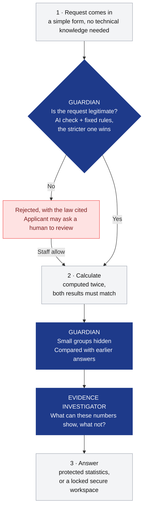

# Health Data Navigator

### Health data for research, decided in seconds, without exposing a single patient.

*AIM Austria hackathon · Track 3: European Health Data Space (EHDS)*


---

## Why our solution stands out

Most data-access apps follow the rules one answer at a time. **Ours thinks like an attacker and like a scientist.**

### 1. We catch the privacy leak that rule-following apps miss

The standard rule says: *never publish a number below 10.* But look what happens when someone asks two harmless questions:


Both answers are above 10, so a normal app releases both, and anyone can subtract them to find one woman in Burgenland. These are real numbers from the official hackathon dataset.

**Our Guardian agent remembers everything it has already published.** It sees that the second answer would expose a tiny group, and it holds that answer back.

### 2. We notice when the purpose quietly changes

A research group is approved for statistics on breast cancer. The same group then comes back and asks for patient records to set **insurance premiums**, which European law forbids.

**The Guardian remembers who asked what and why.** It refuses the new request and alerts staff.


### 3. We tell researchers what their numbers can *not* prove

Numbers without context invite wrong conclusions. Say a researcher finds 72 women with breast cancer who have a recorded BMI and asks: *"Does obesity cause breast cancer?"* In our data, **every one of those BMI values was measured after the diagnosis.** The numbers show that the two occur together, but not that one caused the other.

**Our Evidence Investigator agent adds this kind of warning to every answer:** what the numbers can show, what they can't, and which study would answer the question properly.

### 4. AI that can only make things safer

The AI reads every request the way an experienced reviewer would: it looks for hidden advertising, insurance or credit motives, and for attempts to identify people. **But it can only make a decision stricter, never looser.** The final decision and every number come from fixed, checkable rules. The AI never sees patient data, and the app gives the same answer every time.

### 5. Perfect score on the official test

| Official check | Our result |
|---|---|
| Correct decisions | ✅ **10 / 10** |
| Correct numbers | ✅ **6 / 6** |
| Privacy leaks | ✅ **0** |
| Same answer on every run | ✅ **10 / 10** |
| Answer time (limit 60 s) | ✅ under 1 s without AI, typically 7–16 s with AI |

---

## The problem we solve

Under the new **European Health Data Space**, every EU country needs a *Health Data Access Body*. When a university, a ministry or a company wants to reuse health data, this body must:

1. **decide** whether the purpose is allowed by law;
2. **compute** the answer from millions of records without exposing anyone;
3. **explain** the decision to the applicant and to staff.

Today this means lawyers reading every application and analysts computing numbers by hand. It is slow, and as shown above, simple tricks still leak patients.

---

## How it works



**Every request gets one of three answers, each with the article of EHDS law behind it:**
- ❌ **Rejected:** a forbidden purpose, such as insurance pricing, advertising, credit scoring or singling people out.
- 📊 **Statistics:** anonymous numbers. Any group with fewer than 10 people is hidden.
- 🔒 **Secure workspace:** the applicant explains why statistics are not enough, for example to train a medical prediction model, and gets access to coded records in a locked room. **Nothing can be downloaded.**

---

## Meet the two agents

### 🛡️ The Guardian: is the request legitimate, and is the answer safe?

| | |
|---|---|
| **What it does** | Checks every request twice. **Before** computing: is the purpose allowed, is it really research, does it fit what this organisation asked before? **Before** releasing: are any groups too small, and could this answer be combined with an earlier one to expose someone? |
| **Why it is needed** | Privacy rules that look at one answer at a time can be tricked by asking two similar questions and subtracting. A purpose can also change between requests. |
| **Why it is good** | It catches what per-answer rules miss. Its privacy checks are fixed rules, so they're predictable and repeatable. Its AI part can only add caution, never remove it. |

### 🔬 The Evidence Investigator: do the numbers support the conclusion?

| | |
|---|---|
| **What it does** | Adds a short note to every answer: what the numbers can show, what they can't (e.g. cause and effect), which groups are hidden, and what analysis would be stronger. |
| **Why it is needed** | Routine health records are easy to over-interpret. "Occurs together" is not "causes", and the timing of measurements matters. |
| **Why it is good** | It helps researchers ask better questions and avoid false conclusions. It only sees the protected result, never patient data, and it can't change the answer. |


---

## See it in action

| Protected statistics + evidence note | Locked secure workspace | Guardian holds back a leak |
|---|---|---|
|  |  |  |

**Also included:**
- 🔒 **Secure workspace:** researchers can run summary queries, but individual rows and patient IDs never leave.
- 👩‍⚖️ **Human in the loop:** rejected applicants can ask for a manual review, and staff decide with a recorded reason.
- 🧾 **Full transparency for staff:** every rule step, the AI's checklist, a double-checked calculation, a result certificate, and a tamper-evident audit log.


---

## Honest limits

We prefer to show what isn't finished yet:
- **No logins yet.** Anyone using the demo can act as staff.
- **The memory works per organisation.** The same trick sent under a different organisation name is not yet caught, and the memory resets when the app restarts.
- **Some unusual wordings are not yet understood.** In those cases a number can be wrong, and staff only see a warning flag.
- **Workspace tools:** only database queries today. SAS, R and Python are planned.

---

<details>
<summary><b>For technical readers: architecture, components, how to run</b></summary>

### Run it

Mac/Linux (Python 3.11+):
```bash
python3 -m venv .venv && .venv/bin/pip install -r requirements.txt
make app                 # http://127.0.0.1:8000
```
Windows (PowerShell):
```powershell
py -3.12 -m venv .venv; .venv\Scripts\pip install -r requirements.txt
.venv\Scripts\python.exe -m uvicorn navigator_app:app --port 8000
```
Optional AI: set `OPENROUTER_API_KEY` before starting (`EHDS_AI_CHECK=0` turns it off). Never commit the key.

Checks: `make eval` (the official metrics), `make test` (all tests, offline, with the AI replaced by a fake model), `make lint`.

### Decisions and articles

| Decision | When | Articles |
|---|---|---|
| `REJECT` | Forbidden use, or no allowed purpose | Art. 54 / Art. 53 |
| `APPROVE_STATISTICAL` | Allowed purpose, aggregate question | Art. 53, 69 |
| `APPROVE_SPE` | Allowed purpose, and a concrete reason why statistics are not enough | Art. 53, 66, 68, 73 |

### Components

| Component | File | What it does |
|---|---|---|
| Request form | `web/` | Dropdowns and ready-made definition lines instead of JSON. "Start from" loads any official or demo request. |
| Fixed rules | `ehds/judge.py` | Art. 54 forbidden uses, Art. 53 purposes, Art. 68 records justification. Picks the decision and the articles. |
| Guardian: AI moderation | `ehds/ai_check.py` | Reviews the application and the organisation's history (no patient data). Can only make a decision stricter. A high-risk finding counts only with an exact quote. |
| Calculation | `ehds/recipe.py`, `ehds/engine.py`, `ehds/reference.py` | Plain-English definitions → SQL on DuckDB, plus an independent Python recount. Nothing is released if they disagree. |
| Privacy gate | `ehds/privacy.py`, `ehds/data.py` | Opted-out patients removed before any calculation. `<10` and `suppressed`, with round half up. |
| Guardian: release memory | `ehds/memory.py` | Patient groups behind every released number. Holds back answers that differ from an earlier one by 1–9 patients. |
| Evidence Investigator | `ehds/evidence.py` | Fixed caveats plus an optional AI review of the protected result. Advisory only. |
| Secure workspace | `ehds/workspace.py` | Per-permit DuckDB file, read-only queries, summary-only output. The download endpoint always answers 403. |
| API, review, history | `server/api.py` | HTTP API, manual review, request history |
| Audit, certificate | `ehds/audit.py`, `ehds/certificate.py` | Hash-chained audit log and a result certificate |

### Models and data

- **Language model:** `mistralai/mistral-small-3.2-24b-instruct` via OpenRouter (`server/llm.py`). Change it with `EHDS_LLM_MODEL`.
- **What the model sees:** only the application text and the protected result table, never patient-level data.
- **Without a key,** the app runs on the fixed rules alone, and all the official metrics are reached that way.
- **Database:** DuckDB in-process on the official `track3-ehds-20k` synthetic CSVs (20,000 patients; opted-out patients excluded).

### Demo requests

- `R01–R10`: the official requests.
- `D01–D05`: reworded bad requests (insurer fees, pharma sales reps, "does my neighbour have diabetes", records without a reason, an app company's "research").
- `D06 → D07 → D08`: an age-band subtraction is held back, then a change of purpose to insurance is rejected.
- `D09`: a justified records request that opens a secure workspace.
- `D10 → D11`: 114 women with breast cancer in Austria, then "without Burgenland". The second answer is held back.

Run D06–D08 and D10–D11 in order, without restarting the app.

### Known technical limitations

- **No authentication.** Roles are self-declared, and the staff endpoints, including "allow" after review, are open.
- **Release memory** is keyed by organisation name and held in RAM. It doesn't catch sums over many requests or exclusions other than regions. When a count is held back, a mean in the same answer can still be shown.
- **Parser gaps** for some new wordings (stays per year, "active" prescriptions, an age given only in a definition line) can produce wrong numbers, with only a staff flag shown.
- **Timing:** with the AI on, requests typically take 7–16 s (slowest seen 38 s). The rules alone take under 1 s.
- **Video and pitch:** [`docs/video_script.md`](docs/video_script.md), [`docs/pitch.md`](docs/pitch.md)

</details>
