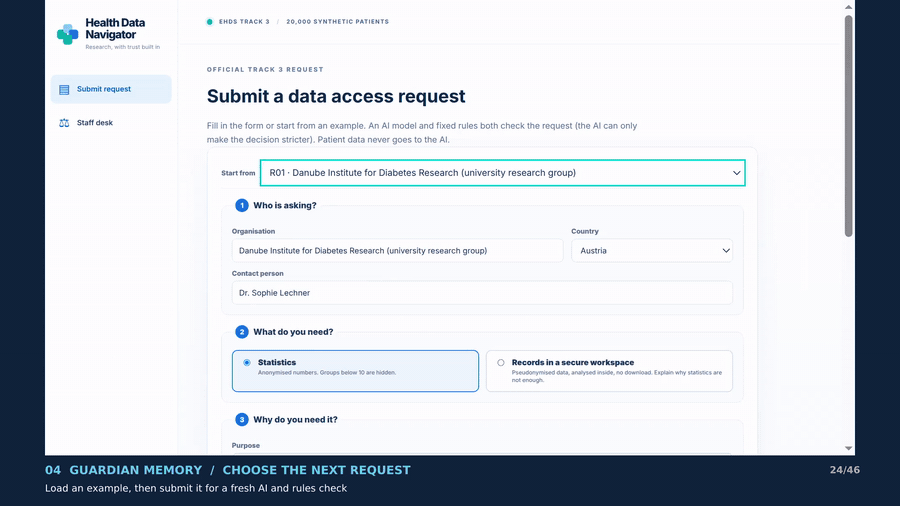
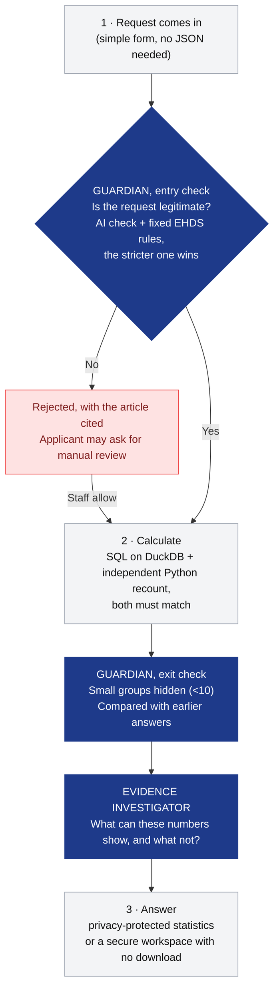
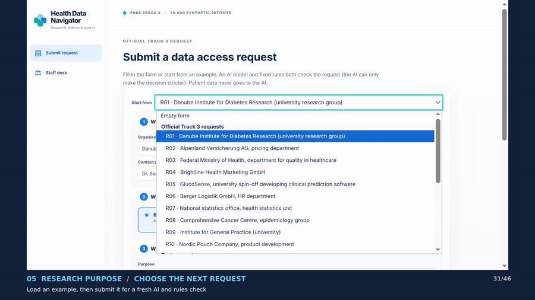
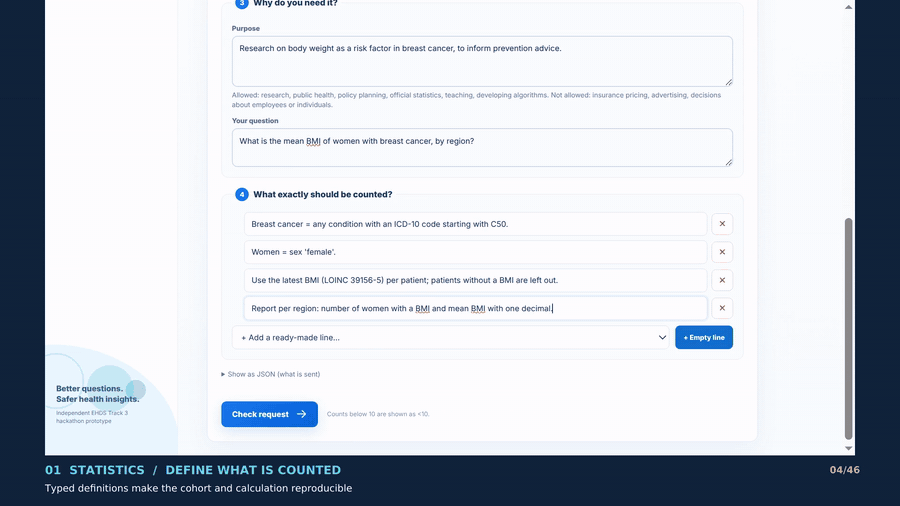
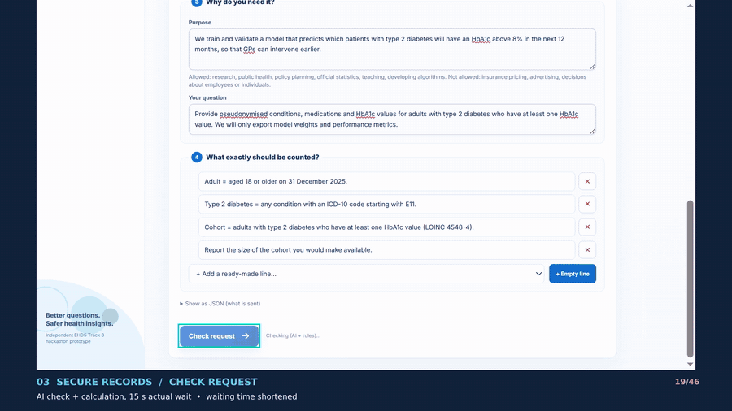
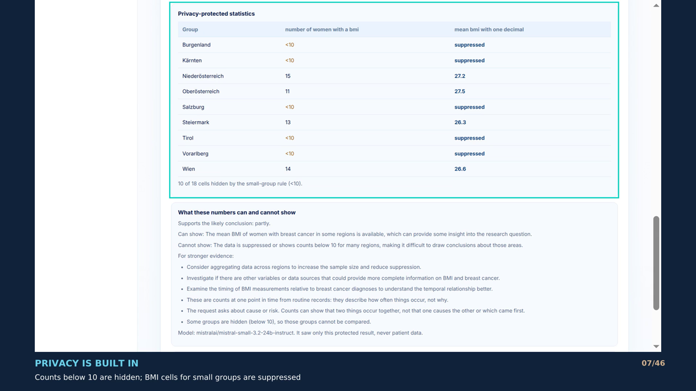
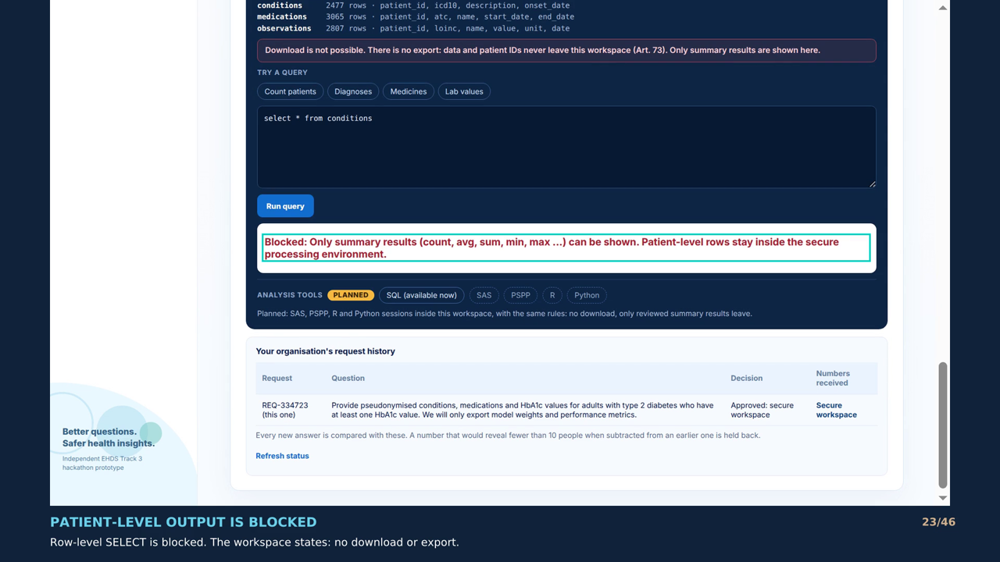
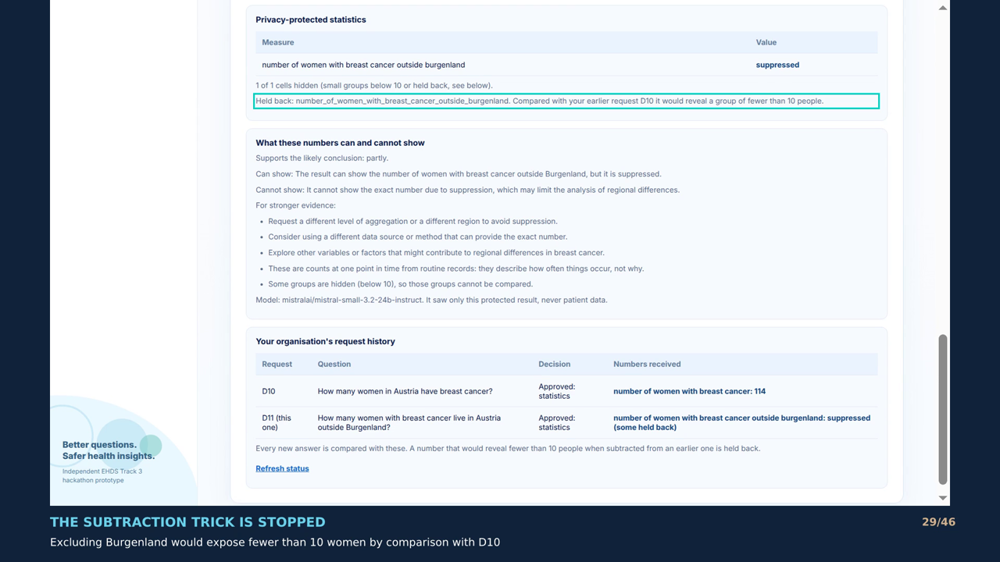

# Health Data Navigator: EHDS Track 3

**A Health Data Access Body that decides in seconds, cites the law, and catches privacy leaks that rule-following apps miss.**

Under the European Health Data Space (EHDS), researchers, public bodies and companies apply to reuse health data. Someone has to decide whether the purpose is allowed, compute the numbers without exposing anyone, and explain the decision. Health Data Navigator does all of this in one checked flow. Two AI agents, the **Guardian** and the **Evidence Investigator**, sit on top of a deterministic engine that does the decisions and the maths.



*Demo: the second request ("same, but without Burgenland") would reveal a handful of women by subtraction, so the Guardian holds it back.*

Demo video script: [`docs/video_script.md`](docs/video_script.md) · 1-minute pitch: [`docs/pitch.md`](docs/pitch.md)

---

## Results on the official test set

| Metric (official `requests/expected.json`) | Target | Result |
|---|---|---|
| Correct decisions | 10/10 | **10/10** (rules alone, and with the AI on) |
| Correct numbers | 6/6 | **6/6** |
| Privacy leaks | 0 | **0** |
| Consistency (3 runs) | 10/10 | **10/10** |
| Slowest answer | < 60 s | **< 1 s** rules only · typically 7–16 s with the AI on (slowest seen 38 s) |

Reproduce offline: `make eval`.

---

## How it works



Every request ends in one of three decisions, each with the EHDS articles that justify it:

| Decision | When | Articles |
|---|---|---|
| `REJECT` | Forbidden use (insurance pricing, advertising, credit, hiring, singling people out) or no allowed purpose | Art. 54 / Art. 53 |
| `APPROVE_STATISTICAL` | Allowed purpose, aggregate question | Art. 53, 69 |
| `APPROVE_SPE` | Allowed purpose, and a concrete reason why statistics are not enough | Art. 53, 66, 68, 73 |

**The AI never computes a number and never approves anything the rules reject.** The decisions and statistics are deterministic, which is why the results are identical across runs.

---

## The Guardian agent: is the request legitimate, and is the answer safe to release?

### What it does

The Guardian checks every request twice.

1. **Before anything is computed (entry check).**
   - **Fixed rules** recognise the forbidden uses in Art. 54 and the allowed purposes in Art. 53.
   - **An AI model** reads the whole application, plus this organisation's earlier requests and the numbers it already received. It looks past the wording: hidden commercial motives, purpose mismatch, re-identification risk, data minimisation, records without a real reason, and sudden changes of purpose.
   - **The stricter of the two wins.** The AI can only make a decision stricter, never looser. A high-risk AI finding only counts if it quotes the request word for word.
2. **Before anything is released (exit check).**
   - **Small-cell rule:** counts below 10 become `<10`, and percentages and means based on small groups become `suppressed`.
   - **Release memory:** the Guardian remembers the exact patient group behind every number it has released. If a new number differs from an earlier one by 1–9 patients, subtracting the two would reveal a small group, so the new number is held back.

### Why it is needed

The usual rule, "never publish a count below 10", checks each answer **on its own**. Attackers don't ask one question; they ask two.


These are real numbers from the official synthetic dataset. Both answers pass the small-cell rule, and together they reveal one woman. Thin slicing works the same way: 345 patients with atrial fibrillation aged 55+, then 344 aged 56+, means exactly one of them is 55.

The same problem exists for **purpose**. An organisation can be approved for research, and then come back with the same data need for insurance pricing.



*Demo D06 → D08: the same organisation that got research statistics now asks for records to set insurance premiums. It is rejected under Art. 54 and flagged to staff as a purpose change.*

### Why it is good

- **It catches what per-answer rules can't:** subtraction across requests, thin slicing, and purpose changes.
- **It is predictable where it matters.** The release memory and the small-cell rule are fixed code, not AI, so the official metrics stay at 10/10 across runs.
- **The AI only adds caution.** It cannot approve a forbidden use, so a model mistake can never open data up.
- **It is explainable.** The applicant gets a plain-language letter, and staff see every rule step, the AI checklist and what was held back, and why.

---

## The Evidence Investigator agent: do the numbers support the conclusion?

### What it does

After the numbers are protected, the Evidence Investigator adds a note to every statistical answer.

- **Fixed caveats, always:** these are counts from routine records, they show association rather than cause, and hidden (`<10`) groups cannot be compared.
- **With the AI on:** a model reads only the question, the definitions and the **protected** result table, never patient data. It says what the numbers can and cannot support, and what analysis would be stronger, for example timing, a comparison group, or confounders.
- **It is advisory only.** It never changes a decision or a number.



### Why it is needed

An access body that hands out numbers without context invites overclaiming. Take this example from our dataset:

> A researcher finds 72 women with breast cancer who have a BMI value and asks: **"Does obesity cause breast cancer?"**

In the data, **every one of those 72 BMI values was measured *after* the breast cancer diagnosis.** The data can show that the two occur together, but they cannot show that obesity came first, let alone that it caused the cancer. Telling the researcher this upfront is cheaper than a retracted paper.

### Why it is good

- **It turns "here are your numbers" into "here is what they can prove".**
- **It is safe by design:** it only sees what the applicant sees anyway, and it can't change the result.
- **It points to the next step:** the stronger study design or data the researcher would need.

---

## Secure processing environment (records requests)

When an applicant justifies why statistics are not enough, for example to train a prediction model on individual histories, the app opens a **secure workspace**. It contains only the selected patients and the record types they asked for, pseudonymised.

- **Queries:** only read-only SQL, and only summary results (count, avg, …) leave the workspace.
- **No data out:** raw rows and patient or encounter IDs are blocked. There is no download button, and the download endpoint always answers `403`.



---

## Staff desk

Staff see every request in a searchable, filterable list. Each request opens with:
- the rule steps;
- the AI checklist;
- the flags;
- the generated SQL;
- the independent recount;
- a result certificate;
- the applicant's history.

Rejected applicants can ask for a manual review, and staff can **allow** it (all privacy checks still run) or **keep** the rejection, with a recorded reason. Every action goes into a hash-chained, tamper-evident audit log.

| Protected statistics | Secure workspace | Guardian hold-back |
|---|---|---|
|  |  |  |

---

## Try it

Mac/Linux (Python 3.11+):
```bash
python3 -m venv .venv && .venv/bin/pip install -r requirements.txt
make app                 # http://127.0.0.1:8000
```
Windows (PowerShell):
```powershell
py -3.12 -m venv .venv; .venv\Scripts\pip install -r requirements.txt
.venv\Scripts\python.exe -m uvicorn navigator_app:app --port 8000
```
Optional AI: set `OPENROUTER_API_KEY` before starting (`EHDS_AI_CHECK=0` turns it off). Never commit the key.

Checks: `make eval` (official metrics), `make test` (all tests, offline, with the AI replaced by a fake model), `make lint`.

**Demo requests** (pick them under "Start from" in the form):
- `R01–R10`: the official requests.
- `D01–D05`: reworded bad requests, e.g. insurer fees, pharma sales reps, "does my neighbour have diabetes", records without a reason, and an app company's "research".
- `D06 → D07 → D08`: an age-band subtraction is held back, then a change of purpose to insurance is rejected.
- `D09`: a justified records request that opens a secure workspace.
- `D10 → D11`: 114 women with breast cancer in Austria, then "without Burgenland". The second answer would reveal 2 women, so it is held back.

Run D06–D08 and D10–D11 in order, without restarting the app.

---

## Under the hood

| Component | File | What it does |
|---|---|---|
| Request form | `web/` | Dropdowns and ready-made definition lines instead of JSON |
| Fixed rules | `ehds/judge.py` | Art. 54 forbidden uses, Art. 53 purposes, Art. 68 records justification. Picks the decision and the articles. |
| Guardian: AI moderation | `ehds/ai_check.py` | Reviews the application and the organisation's history. Can only make a decision stricter. |
| Calculation | `ehds/recipe.py`, `ehds/engine.py`, `ehds/reference.py` | Plain-English definitions → SQL on DuckDB, plus an independent Python recount. Nothing is released if they disagree. |
| Privacy gate | `ehds/privacy.py`, `ehds/data.py` | Opted-out patients removed before any calculation. Small-cell suppression with round half up. |
| Guardian: release memory | `ehds/memory.py` | Patient groups behind every released number. Holds back answers that differ by 1–9 patients. |
| Evidence Investigator | `ehds/evidence.py` | Fixed caveats plus an optional AI review of the protected result |
| Secure workspace | `ehds/workspace.py` | Per-permit DuckDB file with read-only queries, summary-only output and blocked downloads |
| API, review, history | `server/api.py` | HTTP API, manual review, request history |
| Audit, certificate | `ehds/audit.py`, `ehds/certificate.py` | Hash-chained audit log and a result certificate |

**Models and services**
- **Language model:** `mistralai/mistral-small-3.2-24b-instruct` via OpenRouter (`server/llm.py`). Change it with `EHDS_LLM_MODEL`.
- **What leaves the app:** only the application text and the protected result table. Patient-level data never goes to the model. OpenRouter is not EU-only.
- **Without a key,** the app runs on the fixed rules alone, and all the metrics above are reached that way.
- **Database:** DuckDB in-process on the official `track3-ehds-20k` CSVs. No other external services.

---

## What works and what does not (yet)

**Works:**
- all 10 official requests are correct, with numbers and articles;
- new requests from the form;
- rejection of reworded forbidden uses;
- small-cell protection and opt-outs;
- subtraction protection between one organisation's requests;
- the secure workspace, with no download;
- manual review with a staff decision;
- the full staff trace and audit log.

**Not yet:**
- **No logins.** Roles are self-declared, and the staff buttons, including "allow" after manual review, are open to anyone using the app.
- **Release memory is per organisation and kept in RAM.** It resets on restart. It doesn't catch the same attack sent under a different organisation name, sums over many requests, or exclusions other than regions (e.g. "without hospital X"). When a count is held back, a mean in the same answer can still be shown.
- **Parsing gaps.** Some new wordings are not yet understood, e.g. "stays per year", "active" prescriptions, or an age given only in a definition line. In these cases the numbers can be wrong, and only a staff flag is shown.
- **Workspace tools:** SQL only. SAS, PSPP, R and Python are shown as planned.
- **AI judgement varies.** The live AI was tested with a stand-in model in our test suite, and its judgement can vary between models. The rules alone reach the full official score.
